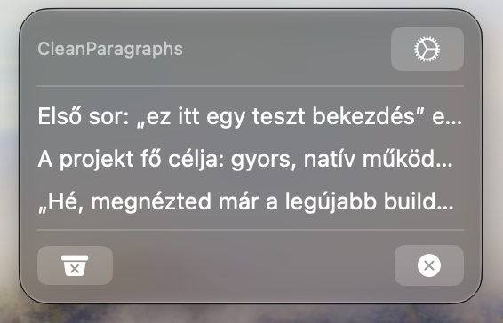
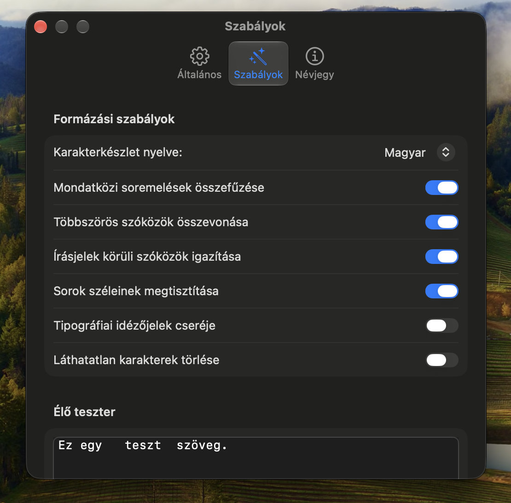

# CleanParagraphs

Egy könnyű segédprogram, amely segít megformázni a vágólapra másolt szövegeket.

##Használat
A szöveg kimásolása után a menüsoron az ikonra kattintva megjelenik az alábbi menü, majd a kimásolt szövegre kattintva a vágólapra a formázott szöveg kerül.

## Funkciók
- Vágólap előzmények, így megmaradnak az előzőleg kimásolt szövegek is.
- Egyszerű ASCII megfelelőkre alakítja a tipográfiai idézőjeleket és kötőjeleket, ahol célszerű.
- Kiszűri a weboldalakról vagy PDF-ekből beszivárgó láthatatlan / nulla szélességű és vezérlőkaraktereket.
- Gyorsan, helyben és feltűnésmentesen tisztítja a vágólapot.

## Támogatás
A CleanParagraphs ingyenesen használható és nyílt forráskódú az **MIT licenc** alatt. Ha megkönnyíti a mindennapi munkát, szívesen fogadok egy kávét vagy egy kisebb honoráriumot **Ko-fi**-n:

[Támogatás Ko-fi-n](https://ko-fi.com/matewastaken)

## Licenc
Az **MIT licenc** feltételei szerint kiadva. Részletek a `LICENSE` fájlban.
